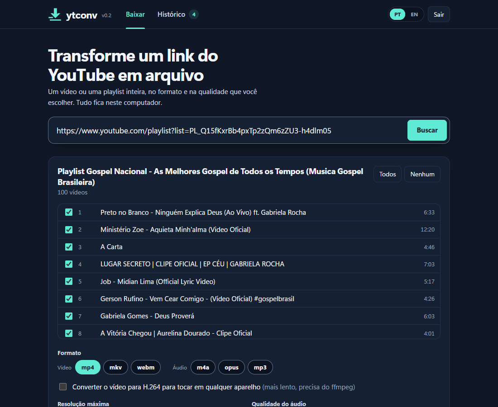
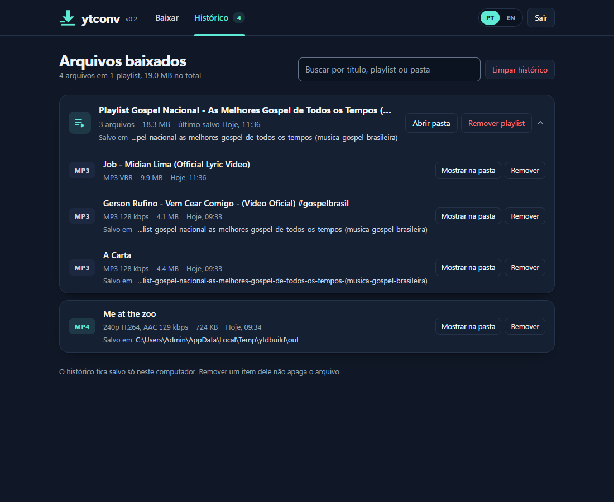

<p align="center">
  
</p>

<h1 align="center">ytconv</h1>

<p align="center">
  <strong>Turn YouTube videos, audio and whole playlists into files you keep —
  from the terminal or from a local web interface.</strong><br>
  A single Go binary: no login, no API key, no Python, no extra programs.
</p>





## Features

- **Videos and audio** in mp4, mkv, webm, m4a, opus or mp3, picking the
  video and audio quality from a list (or `--best`).
- **Whole playlists**: every video of a playlist in one command, with
  position ranges (`--items 1-10,15`), resume after an interruption and a
  final saved/skipped/failed report.
- **Web interface** (`ytconv gui`) in **English and Portuguese**: paste a
  link, pick the format and quality and follow the download queue with live
  progress, cancel and "show in folder".
- **Download history**: every saved file, with the playlists grouped
  together, the quality, the size, when it was saved and the folder it went
  to. Search it, open the folder, or remove entries (the files stay on disk).
- **Quality options**: exact video/audio streams for a single video;
  maximum resolution (4K down to 144p), audio quality (best, medium,
  smallest) and MP3 bitrate (VBR, 320, 256, 192, 128 kbps) for playlists.
- **Lossless and fast**: streams are copied as YouTube serves them, downloaded
  over parallel connections and muxed in pure Go. ffmpeg is only needed for
  mp3 and `--h264`.
- **Runs anywhere**: static binaries for Windows, macOS and Linux
  (amd64/arm64). On Windows, double-click `ytconv.exe` to open the interface.

## Install

**Windows, macOS, Linux:** download the archive for your system from
[Releases](https://github.com/M0abl1/youtube_converter/releases) and unpack it.

**macOS / Linux, one line:**

```sh
curl -fsSL https://raw.githubusercontent.com/M0abl1/youtube_converter/main/install.sh | sh
```

**From source** (Go 1.22+):

```sh
git clone https://github.com/M0abl1/youtube_converter
cd youtube_converter
go build -o ytconv .     # ytconv.exe on Windows
```

## Usage

```sh
ytconv down 'https://www.youtube.com/watch?v=aqz-KE-bpKQ'    # pick quality, get an mp4
ytconv down aqz-KE-bpKQ                                      # same, video ID only
ytconv down https://youtu.be/aqz-KE-bpKQ --best              # no prompts, best quality
ytconv down <url> --format webm                              # VP9/AV1 + Opus
ytconv down <url> --format mkv                               # any codec combination
ytconv down <url> --audio-only                               # m4a (AAC)
ytconv down <url> --format opus                              # Opus audio
ytconv down <url> --format mp3                               # needs ffmpeg
ytconv down <url> --max-res 720 --audio-quality medium      # no prompts, up to 720p
ytconv down <url> --h264                                     # VP9/AV1 -> H.264, needs ffmpeg
ytconv down 'https://www.youtube.com/playlist?list=PL...' --format mp3   # a whole playlist
ytconv gui                                                   # graphical interface
```

Accepted inputs: `watch?v=`, `youtu.be/`, `shorts/`, `embed/`, `live/`,
`music.youtube.com` links, or a bare 11-character video ID. For playlists:
`playlist?list=` links (also on `music.youtube.com`) or a bare playlist ID.

Quote URLs that contain `?` or `&`. Without quotes, zsh treats `?` as a
filename pattern and stops with `no matches found` before ytconv runs, and any
shell treats `&` as "run in background". To paste `watch?v=` links unquoted
in zsh, add this to `~/.zshrc`:

```sh
alias ytconv='noglob ytconv'
```

| Flag | Default | |
|---|---|---|
| `--format` | `mp4` (`m4a` with `-a`) | `mp4`, `mkv`, `webm`, `m4a`, `opus`, `mp3` |
| `-a, --audio-only` | | audio only |
| `-b, --best` | | skip the prompts, pick the best quality |
| `-i, --itag` | | skip the prompts, pick streams by itag: `VIDEO+AUDIO` (e.g. `337+251`), or `AUDIO` with `-a`. Itags are shown in the selector |
| `-o, --output-dir` | `~/Downloads` | where the file goes |
| `-f, --filename` | slugified title | output name; a known extension also sets `--format` |
| `-c, --connections` | `8` | parallel connections |
| `--h264` | | re-encode to H.264 for old players |
| `-t, --tmp-dir` | system temp | where streams are stored before muxing |
| `--playlist` | | with a `watch?v=…&list=…` URL, download the whole playlist instead of the one video |
| `--items` | all | playlist positions to download, e.g. `1-10,15` or `20-` |
| `--max-res` | best | skip the video prompt and use the best stream up to this height, e.g. `1080`, `720`, `480` |
| `--audio-quality` | best | skip the audio prompt and use the `best`, `medium` or `low` bitrate stream |
| `--mp3-bitrate` | best VBR | with `--format mp3`: `320`, `256`, `192` or `128` kbps |
| `--no-playlist-dir` | | save playlist videos directly in `--output-dir` instead of a sub-folder |

The selectors only list streams that fit the chosen format without
re-encoding:

| Format | Video | Audio |
|---|---|---|
| mp4 | H.264, AV1 | AAC |
| webm | VP9, AV1 | Opus |
| mkv | H.264, AV1, VP9 | AAC, Opus |
| m4a | | AAC |
| opus | | Opus |

Want 1440p/4K VP9 or Opus audio? Use `--format webm` or `--format mkv`.

Output files get title and artist metadata and never overwrite an existing file.

### Playlists

```sh
ytconv down 'https://www.youtube.com/playlist?list=PL_Q15fKxrBb4pxTp2zQm6zZU3-h4dlm05' --format mp3 --mp3-bitrate 192
ytconv down 'https://www.youtube.com/playlist?list=PL_Q15fKxrBb4pxTp2zQm6zZU3-h4dlm05' --max-res 720
ytconv down 'https://www.youtube.com/watch?v=LYsaKn8FRhc&list=PL_Q15fKxrBb4pxTp2zQm6zZU3-h4dlm05' --playlist --items 1-10
```

- Every video gets the best quality that fits the format, without prompts,
  or the quality set by `--max-res`, `--audio-quality` and `--mp3-bitrate`
  (`--itag` and `--filename` cannot be used, since they are per video).
  A video that only exists in a higher resolution than `--max-res` uses its
  smallest one.
- Files go into a folder named after the playlist inside `--output-dir`.
- Videos already saved in that folder are skipped, so running the same
  command again resumes an interrupted playlist.
- A video that fails does not stop the others. A stream URL that expires
  (HTTP 403) is retried once with fresh URLs. At the end ytconv prints how many
  were saved, skipped and failed, lists the failed ones and exits with 1 if
  any failed.
- A `watch?v=…&list=…` link still downloads just that video unless you add
  `--playlist`. Mixes (`list=RD…`) are generated per viewer and cannot be
  downloaded as a playlist.

## Graphical interface

```sh
ytconv gui                      # opens the interface in your browser
ytconv gui --port 8765 --no-open
```

`ytconv gui` starts a small web page served by ytconv itself and opens it in your
default browser. Paste a video or playlist link, pick the format and the
quality, choose the folder and follow the downloads in the queue, with cancel
and "show in folder" buttons. On Windows, double-clicking `ytconv.exe` does
the same.

- **Download / History tabs**: the history lists every file saved through
  the interface, newest first. Videos from the same playlist are grouped
  under the playlist name, and each file shows its quality, size, date and
  folder, with "Show in folder" (or "Open folder" when the file was moved or
  deleted). It is stored only on your computer, in
  `%AppData%\ytconv\history.json` on Windows, `~/Library/Application Support/ytconv/`
  on macOS and `~/.config/ytconv/` on Linux; set `YTCONV_HISTORY` to use
  another file.
- **Language**: English or Portuguese (PT/EN switch in the corner). The
  first visit follows the browser language; the choice is remembered.
- **Single video**: pick the exact video and audio stream (resolution,
  codec, bitrate and size are listed), or leave "Best available".
- **Playlist**: pick a maximum resolution (4K, 1440p, 1080p, 720p, 480p,
  360p, 240p, 144p) and an audio quality (best, medium, smallest file) that
  apply to every selected video.
- **MP3**: pick the bitrate (best VBR, 320, 256, 192 or 128 kbps).

It needs no extra program or library: the page is built into the ytconv binary.
ytconv stops when you press Ctrl+C, click Quit, or about 30 seconds after the
last ytconv tab is closed with nothing left to download.

The server only listens on `127.0.0.1`. Every request must carry the random
token that is part of the address ytconv opens, and requests with another
`Host` or `Origin` are refused, so other websites cannot use it to download
files to your computer.

## How it works

1. **Extraction** (`pkg/youtube`), ported from yt-dlp's YouTube extractor.
   ytconv gets an anonymous visitor ID from `youtube.com/sw.js_data` (3 KB, where
   yt-dlp downloads the 1 MB+ watch page) and calls the InnerTube `player`
   API as the visionOS client. yt-dlp ships that client as its "no JS runtime"
   default: it needs no PO token and returns stream URLs without signature or
   `n` challenges, so there is no player JavaScript to download and run.
2. **Download**: both streams are fetched at once, split into 10 MB ranges
   (yt-dlp's chunk size for YouTube) over 8 HTTP/1.1 connections, written in
   place with retries.
3. **Muxing** (`pkg/media`): fragmented MP4 and WebM demuxers, and writers for
   progressive MP4/M4A (moov first, edit lists kept for B-frames, iTunes
   tags), Matroska/WebM (with Cues for seeking) and Ogg Opus. AV1 temporal
   delimiters are dropped like ffmpeg does. The packets and timestamps match
   what `yt-dlp` + ffmpeg produce for the same streams.

## Benchmark

These numbers were measured by the author of the original download engine
([Sn0wye/ytd](https://github.com/Sn0wye/ytd)), which ytconv uses unchanged.

Method (`bench/bench.py`): both tools get the same streams (`ytconv --itag V+A`
vs `yt-dlp --ignore-config -f V+A --merge-output-format …`) and run strictly
one at a time. Each round runs both back to back, alternating which goes
first, and the result is the per-round ratio `t_yt-dlp / t_ytconv`: network
drift hits both runs of a pair alike, so the ratio cancels most of it. The
speedup is the geometric mean of 7 ratios with a 95% confidence interval. As a
cross-check, a googlevideo probe (80 MiB, 4 connections, a stream not under
test) before every run normalises each time to the mean line speed.
yt-dlp 2026.10.26 waits 4–6 s per run ("Sleeping … as required by the
site"), so the speedup is also shown with that wait removed. Times are wall
clock, including extraction and merging.

[b8wsjx7dFwM](https://www.youtube.com/watch?v=b8wsjx7dFwM) (6:00, 4K60 SDR,
3840x1600), best stream per codec plus the best audio for the container:

| Codec → container | Streams | ytconv median | yt-dlp median | Speedup (95% CI) | Normalised | Without yt-dlp's sleep |
|---|---|---|---|---|---|---|
| H.264 1080p60 → mp4 | 299 + 140 AAC, 179 MiB | 3.6 s | 12.2 s | **3.46x** (3.19–3.75) | 3.33x (2.98–3.72) | 2.14x (1.93–2.36) |
| VP9 2160p60 → webm | 315 + 251 Opus, 603 MiB | 10.2 s | 23.9 s | **2.34x** (2.04–2.67) | – | 1.90x (1.63–2.23) |
| AV1 2160p60 → mp4 | 401 + 140 AAC, 627 MiB | 14.0 s | 30.0 s | **2.10x** (1.90–2.31) | 2.00x (1.61–2.49) | 1.79x (1.62–1.97) |

[LXb3EKWsInQ](https://www.youtube.com/watch?v=LXb3EKWsInQ) (5:14, 4K60 HDR10),
3 rounds, before the paired method:

| Codec → container | Streams | ytconv median | yt-dlp median |
|---|---|---|---|
| H.264 1080p60 → mp4 | 299 + 140 AAC | 3.6 s | 12.4 s |
| VP9 2160p60 HDR → webm | 337 + 251 Opus | 18.1 s | 37.8 s |
| AV1 2160p60 HDR → webm | 701 + 251 Opus | 14.8 s | 37.6 s |

Every interval excludes 1.0. ytconv's run-to-run variation (CV) was 4–11%,
yt-dlp's 7–11%. In every case the packets and timestamps of both outputs are
identical (`ffmpeg -f streamhash`, `-f framecrc`), and so are codec, colour
and HDR10 metadata (`ffprobe`). `yt-dlp -N 8` changed little (1–5%) because
it parallelises fragmented streams, not these plain HTTPS ones.

The VP9 normalised figure is missing because the line probe failed during
that run (rate limited). Heavy benchmarking eventually gets the IP flagged by
YouTube ("Sign in to confirm you're not a bot") for both tools; space the runs out.

## Limitations

- No 5.1 audio (those streams come from YouTube clients that need the player
  JavaScript) and no live streams.
- Age-restricted and members-only videos need a login, which ytconv does not do.
- "Made for kids" videos are not served to the visionOS client.
- Private, deleted and members-only videos of a playlist are left out.
- YouTube changes its clients from time to time. If downloads start failing,
  compare `pkg/youtube/client.go` with `INNERTUBE_CLIENTS` in yt-dlp's
  `yt_dlp/extractor/youtube/_base.py`.

## Project layout

| Path | What it does |
|---|---|
| `cmd/` | CLI commands (Cobra): `down`, `gui`, `version` |
| `pkg/youtube/` | InnerTube client: video info, stream selection, playlist listing |
| `pkg/downloader/` | Per-video pipeline shared by the CLI and the web UI |
| `pkg/gui/` | Local HTTP server, job queue, SSE progress, embedded web app |
| `pkg/history/` | Local download history (JSON file, atomic writes) |
| `pkg/media/` | MP4 / WebM / Matroska / Ogg demuxers and writers |
| `pkg/ffmpeg/` | ffmpeg discovery for mp3 and H.264 re-encoding |
| `pkg/ui/` | Terminal output and interactive quality pickers |

```sh
go test ./...   # unit tests, including playlist parsing against real API fixtures
```

The Windows icon and file details come from `rsrc_windows_*.syso`, made
from `winres/icon.png` with
`go run github.com/tc-hib/go-winres@v0.3.3 simply --arch amd64,arm64 --icon winres/icon.png`.

## Visual identity

| | |
|---|---|
| Logo | A download arrow landing on two bars: a stream becoming a file on disk. [`docs/logo.svg`](docs/logo.svg) |
| Navy `#101827` | Background in dark mode, text in light mode |
| Mint `#5EEAD4` | Buttons, selected controls and download progress |
| White `#F1F5F9` | Text in dark mode, background in light mode |
| Slate `#94A3B8` | Secondary details in dark mode (sizes, dates, folders) |
| Deep teal `#0F766E` | Light mode only: mint used as text, outlines and progress, so it stays readable on white |

The web interface follows the system light or dark appearance. Dark is the
brand's default.

Releases are built by GoReleaser from a GitHub Actions workflow on every
`v*` tag.

## Credits and license

MIT — see [LICENSE](LICENSE).

ytconv is built on the download engine of [ytd](https://github.com/Sn0wye/ytd)
by Gabriel Trzimajewski (InnerTube extraction, parallel downloader and
muxers), also MIT-licensed. Playlist support, the web interface and the shared
downloader package were written by me for this project; the git history
keeps each commit under its real author.
